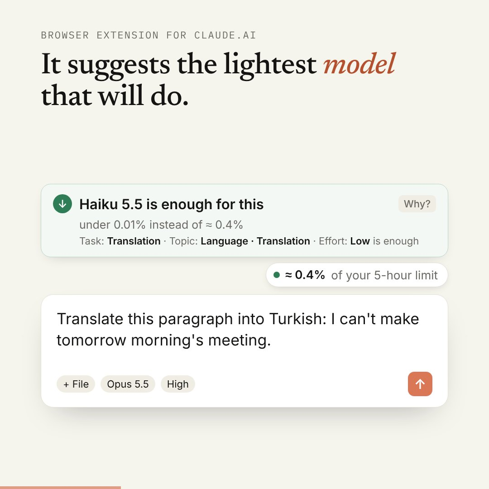
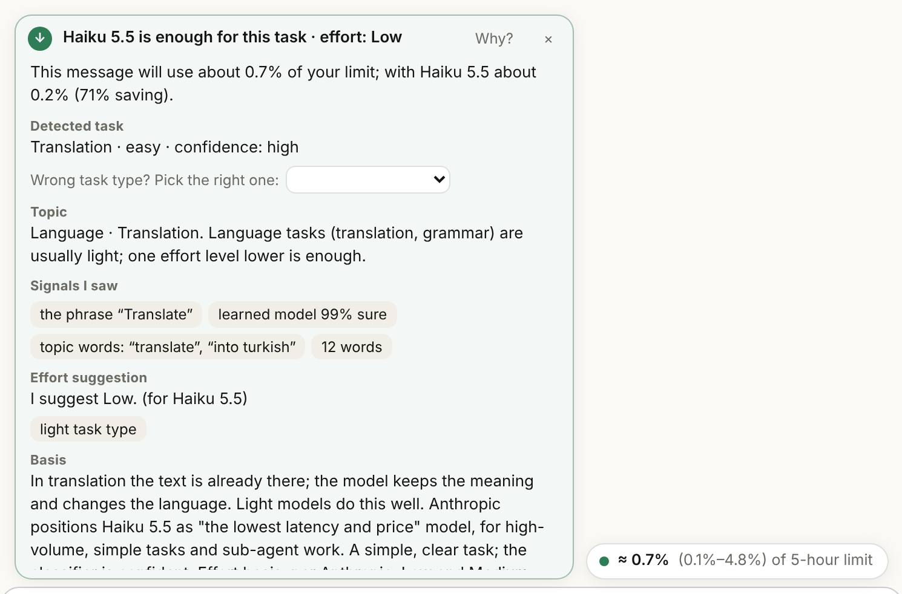
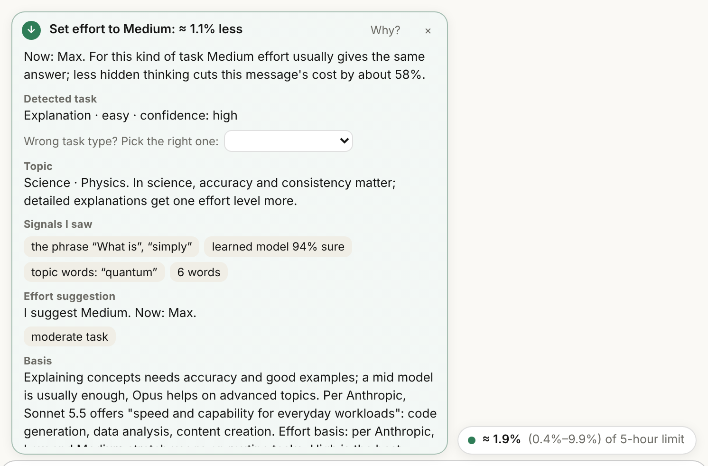
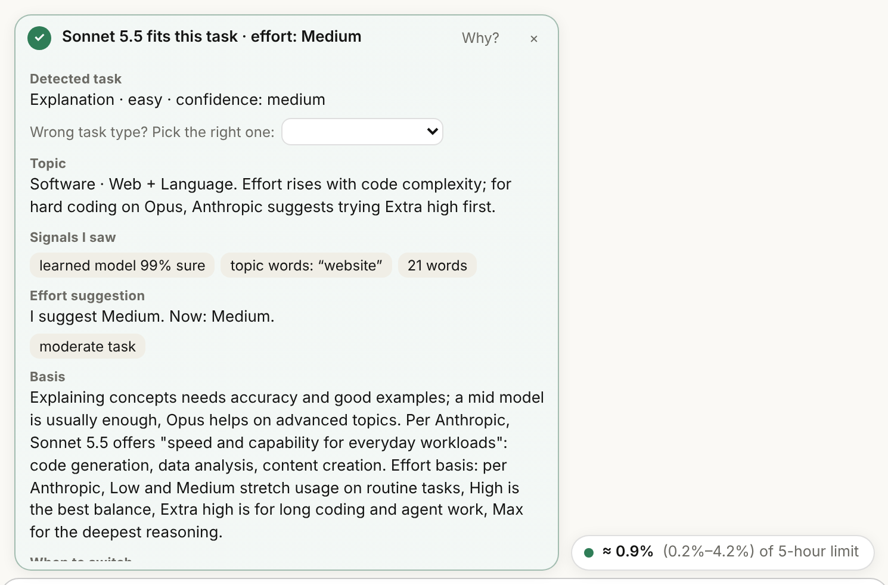
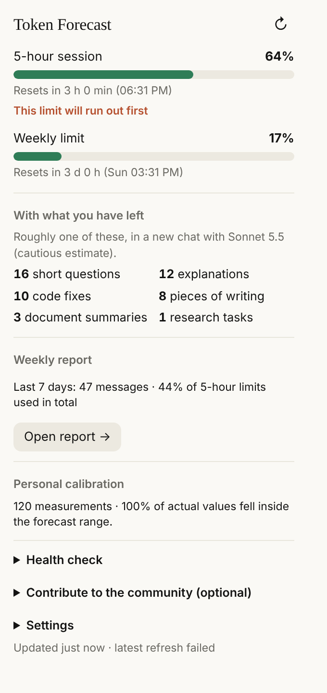
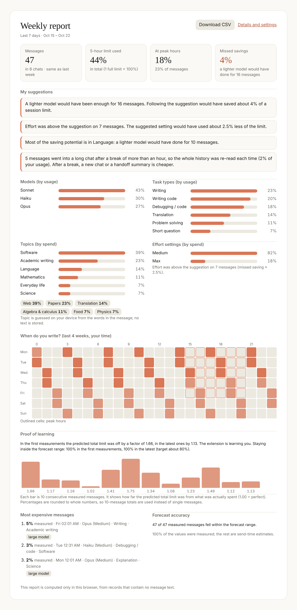

<div align="center">

# Token Forecast

**Know what a message will cost *before* you send it.**

A free browser extension for [claude.ai](https://claude.ai) that predicts how much of your 5-hour and weekly Claude limit a message will use, tells you which model and effort level are enough (with reasons), and learns your plan over time. Everything runs in your browser.

[](LICENSE)


**[⬇ Add to Chrome — free, from the Chrome Web Store](https://chromewebstore.google.com/detail/chbjpjhmkpgfocnfpdafkakjicdicige)**

[Chrome Web Store](https://chromewebstore.google.com/detail/chbjpjhmkpgfocnfpdafkakjicdicige) · [Website](https://h-enes1.github.io/ai-assistant-claude/) · [Releases](https://github.com/H-ENES1/ai-assistant-claude/releases) · [Türkçe README](README.tr.md)

<a href="https://h-enes1.github.io/ai-assistant-claude/"></a>

▶ **[Watch the full walkthrough on YouTube (4 min)](https://www.youtube.com/watch?v=TKogrZgveAM)** · [Türkçe](https://www.youtube.com/watch?v=6Y4qZ-G2AS0)

<sub>47-second intro video and a live demo of the real prediction engine are on the website. The interface in the video is illustrative; the numbers come from the extension's own engine.</sub>

</div>

---

## Why this exists

Claude Code shows your usage. The claude.ai chat screen does not. On claude.ai you open *Settings → Usage*, and there you only see what you have **already** spent. Limits often run out in the middle of a job, on a message you did not expect to be expensive.

Token Forecast brings that into the chat and goes one step further: it tells you **before you press send**.

| Feature | Settings → Usage | Usage meters* | **Token Forecast** |
|---|:-:|:-:|:-:|
| 5-hour and weekly percentage, reset time | ✅ | ✅ | ✅ |
| Inside the chat, next to the message box | ❌ | ✅ | ✅ |
| What this message will cost, before sending | ❌ | ❌ | ✅ |
| Which model is enough, and why | ❌ | ❌ | ✅ |
| Hidden cost of switching model mid-chat | ❌ | ❌ | ✅ |
| Roughly how many tasks the remaining limit allows | ❌ | partly | ✅ |
| Learns from your plan and habits | ❌ | ❌ | ✅ |
| "Why was that message so expensive?" explanation | ❌ | ❌ | ✅ |
| Weekly report, hourly heatmap, personal tips | ❌ | partly | ✅ |
| Cache and peak-hour countdowns | ❌ | partly | ✅ |

<sub>* We looked at the pages of eight usage extensions in October 2026. None offered a per-message estimate before sending or a reasoned model suggestion; all show usage after sending. One has a cache countdown, one a peak-hour countdown, one a heatmap.</sub>

## Screenshots

### A forecast and a reasoned suggestion above the message box



A small pill shows the percentage of your limit the message will use, with an 80% range. Open **Why?** to see the detected task, the topic, what the extension looked at, and the basis for the suggestion (Anthropic's model-choice guide). If it is not sure, it never suggests a light model.

### Effort suggestions



From Low to Max: which effort level is enough for this task, and how much limit you would save if your current setting is higher. It knows each model's default and the Extra high level.

### It looks at the task, not the word



"I need a website with a translation system" is a build job, not a translation. The extension tells the difference and does not suggest Haiku. The automated tests contain 15 trap sentences like this plus real translation requests.

### Toolbar window



Your 5-hour and weekly limits, what the remaining limit still allows (short questions, explanations, code fixes…), the weekly report, and the state of your personal calibration.

### Weekly report



Messages, limit spent, peak-hour share, model and task mix, topic and effort mix, a 7×24 hourly heatmap, the most expensive messages, forecast accuracy, a learning-proof chart and personal tips. Computed only in your browser from text-free records. Monday-morning notification, CSV export.

---

## What it does

### Before you send
- **Forecast before sending.** Prompt, attachments (images, PDF, Word, Excel, text), chat history, model, effort and cache state → percentage of your limit, with an 80% range.
- **Reasoned model suggestion.** Which model is enough, what it looked at, the basis, and how much you would save. 👍/👎 and a "wrong task type?" correction tune it to you.
- **Topic recognition.** Classifies a message into 16 topic areas and sub-topics (Science · Physics, Engineering · Electrical…) using about 2,600 keywords. For health, law and money questions it never suggests a light model.
- **Effort suggestion.** Low to Max, with the savings if your setting is higher. Creative writing is capped at Medium; proofs get at least High; hard coding on Opus can reach Extra high.
- **Cost breakdown.** How much of the cost comes from the answer, the reasoning, the history and the attachments.
- **Cache and peak-hour countdowns.** How many more minutes the chat history is read for free, and when peak hours end.
- **A pill you can move.** Drag it anywhere (or use Alt + arrow keys). It steps aside by itself when claude.ai's own model or effort menu opens.

### While you spend
- **At this pace, when does it run out?** Looks at your last hour and tells you whether the 5-hour limit fills before it resets.
- **Hand-off summary.** When a chat gets too long, one click copies a ready prompt asking Claude for a short summary to carry into a new chat.
- **Warnings and notifications.** "May not fit", context window, cache and peak hours; 50% / 75% / 90% thresholds and a "limit reset" notification; a toolbar badge.

### After you send
- **"Why was that so expensive?"** When the measured usage is far above the forecast, it lists likely reasons: history re-read after a long pause, peak hours, a long answer, or use on another device.
- **Weekly report** (see above).

### It learns
- **Personal calibration.** After every message it measures how your limit actually changed and learns your plan size (`k`), the peak-hour effect and the length of the answers Claude gives you.
- **An on-device task model.** Rules plus a small logistic-regression model (128 KB). Your corrections are learned on your device; what is stored is weight differences, never text.
- **Community priors (optional).** If you choose, you can copy a text-free summary of what was learned and paste it into a form, so new users start from real measurements instead of guesses. Nothing is sent automatically. `tools/aggregate.mjs` merges contributions.
- **Learning proof.** The report shows, from your own measurements, whether the forecast error is shrinking. If it is not, it says so.

### 10 interface languages
Turkish, English, German, French, Spanish, Italian, Portuguese, Russian, Japanese and Chinese, for both the extension and the website.

> **Honest limit:** message *analysis* (task type, topic, model and effort suggestions) currently works only for Turkish and English messages. In other languages you still get the token and limit forecast (token counting is tuned per language, but measured on fewer samples), without suggestions; the extension tells you so.
>
> The translations are machine translations that no native speaker has reviewed yet. Corrections are welcome.

### View switches
*Settings → View*: **Full** (forecast plus every suggestion) or **Compact** (forecast and limit/context warnings only), with individual switches for the model suggestion, effort suggestion, tips and the "why so expensive" explanation. Forecast, limit-full and context warnings are always shown.

---

## Install

**[Add it from the Chrome Web Store](https://chromewebstore.google.com/detail/chbjpjhmkpgfocnfpdafkakjicdicige)** in one click. Edge and Brave can install from the same page; Opera works with the “Install Chrome Extensions” add-on.

### Manual install (developer mode)

If you prefer, download the zip from [Releases](https://github.com/H-ENES1/ai-assistant-claude/releases) and load it unpacked. The same steps work in Chrome, Opera, Edge and Brave.

1. Unzip it into a folder (`manifest.json` must be directly inside).
2. Go to `chrome://extensions` (Opera: `opera://extensions`) and turn on **Developer mode**.
3. **Load unpacked** → pick the folder. Reload your claude.ai tab.

**Updating without losing what it learned:** before removing the old version, open the extension window → Settings → **Export my data**; after installing the new one, use **Import my data**.

**Something not working?** The **Health check** in the window shows the state of every step. Use **Copy log** when reporting a bug; the log contains no message text.

## How it works

```
cost  = w_model × [ new input + uncached history + tool input + 5 × (answer + thinking) ]
limit% = k_plan × cost        (k is learned separately for peak hours)
```

- **Token counting:** separate coefficients for Turkish, English and code, plus per-language factors for other Latin scripts (1.22 tokens/char), Cyrillic (1.54) and CJK (0.73).
- **Answer length:** log-normal, with per-task-type parameters derived from the [CASTILLO](https://arxiv.org/abs/2505.16881) dataset (12 task types).
- **Task type:** rules (12 types, Turkish + English) produce scores; a small learned model uses those scores and word/character features together (`lib/learn.js`, weights in `lib/learn-weights.js`, training in `tests/ml/train.mjs`).
- **Uncertainty:** Monte Carlo (800 samples, reproducible).
- **Calibration:** Gamma-Poisson for `k`, hierarchical normal for answer length, an outlier filter and a 45-day half-life.
- **Measurement:** claude.ai sends messages from a Web Worker, so the main path is the page structure (the last user message changed = sent; the answer stopped growing = done). Usage is read at send time and 4 s and 30 s after the answer.
- **Cache:** a chat used within the last hour is read from the cache and does not count toward your limit. Switching model in a long chat makes the new model re-read the whole history, and the extension warns you.

### Does it actually learn? We measured.

200 simulated users with hidden true values (120 messages each) run the **real** forecast and calibration code of the extension. Each message is first predicted, then the truth is revealed and learned from.

| | Result |
|---|---|
| Error on a block's total: first 3 messages → last 40 | **2.04× → 1.40×** (a copy that does not learn stays at ~2.1–2.2×) |
| 80% prediction interval covers the truth | **≈ 79%** of the time (target 80%) |
| Single-message error: learning / perfect predictor floor | 1.74× / 1.71× |
| Calibration simulation: 300 virtual plans up to 2× off the initial guess | median error **1.68×** at the first message → **1.13×** after 20 → **1.08×** after 100 |

Reproduce with `npm run proof` and `npm run proof:classifier`.

**What this does not prove:** the users are simulated, so real accounts may differ (the report's *Learning proof* section checks you against your own measurements). The spend of a single message cannot be known in advance, because answer length and hidden reasoning are random; the learning forecast falls to that randomness floor (about 1.7×) and cannot go lower. The goal is to hit the total and the interval.

### Task recognition accuracy (honest numbers)

| | Rules only | Rules + learned model |
|---|---|---|
| Task type, test 2 (120 everyday messages, written without looking) | 64% | **88%** |
| Task type, test 1 (120 messages; seen while the training data was being extended) | 61% | 90% |
| Dangerous mistakes (taking a hard task for an easy one), two tests | 16 | 4 |
| Correct Haiku suggestions / wrong Haiku suggestions (two tests) | 32/80 · 0 | 66/80 · 1 |
| Suggestion test set (60 prompts): suitable · lighter than needed | 100% · 0 | 100% · 0 |

Topic recognition is keyword-based: on a nearly blind set of 90 messages written after the rules were finished, it found 71% with 1 wrong area; when it finds nothing it says "General" and the suggestion does not change.

The training and test messages were also written by the project, and accuracy on **real users' messages has not been measured**. Whether the suggested model or effort actually keeps the answer quality **has not been measured either**: the basis is Anthropic's documentation and support articles.

## Privacy

On first install a consent page shows exactly what the extension reads and keeps; **nothing is read until you agree**. Everything is computed in your browser. Your message text, attachments and chats never leave your device. The extension has no server, no analytics and no tracking. It only runs on claude.ai, with your own session, and reads:

- the data of claude.ai's usage page (your 5-hour and weekly percentages);
- the length of the open chat's history, for cache and context calculations;
- the text and attachments in the message box, only to count tokens, locally.

Permissions: storage, alarms, notifications, and only the `claude.ai` site. Full [privacy policy](https://h-enes1.github.io/ai-assistant-claude/privacy.html). It never sends messages, changes settings or automates anything. The weekly report and the learned values contain no message text. A community contribution is shared only if you view it and copy it yourself. The end-to-end test checks the network: only requests to claude.ai, and the single POST is the page's own `/completion`.

## Known limitations

- It relies on claude.ai's **undocumented internals**. If Anthropic changes the page, an update is needed; the health check shows it immediately. Fragile modules: `lib/usage.js`, `lib/page.js`, `lib/conversation.js`, `inject/hook.js`.
- Reasoning tokens are never visible on claude.ai; they are learned only indirectly from usage changes.
- Using the same account on another device or in Claude Code at the same time can disturb measurements (the outlier filter removes most of it, and there is an "used elsewhere" explanation).
- Plan limit sizes and the peak-hour multiplier start as rough guesses. Anthropic does not publish them, so the extension learns them by measuring.
- Peak hours (weekdays 05:00–11:00 Pacific) fill the 5-hour limit faster; the multiplier is unpublished and learned.
- The basics (message box, model and effort selectors, usage reading and page-based measurement) were verified on the real claude.ai in October 2026 (v0.9.5, 3 measurements). The newer features were tested on a mock claude.ai page only.
- Not an official Anthropic tool.

## Development

```bash
npm install            # esbuild + playwright
npm test               # unit, learning, report, contribution, advisor, effort, domain, traps, language tests
npm run e2e            # Playwright against a mock claude.ai (60 checks)
npm run proof          # learning proof with simulated users
npm run build          # minified store package in dist/ (also adds the license headers)
node tests/ml/train.mjs  # retrain the task classifier
```

```
extension/                 the folder you load into the browser (manifest.json is here)
  background.js            service worker: usage reading, notifications, badge, the ONLY writer of calibration
  inject/hook.js           MAIN world; wraps fetch and reads usage from the response stream
  content/content.js       page logic: prompt/attachment reading, forecast, panel (pill), onSend/onDone
  popup/                   toolbar window and the full-page weekly report
  lib/                     usage, tokens, classify, domain, effort, advisor, forecast, calibrate,
                           learn, report, contrib, i18n, … (each a small module)
  _locales/<lang>/         every user-facing string, 477 keys × 10 languages
tests/                     unit tests, e2e.cjs, learning-proof.mjs, ML train/test data
tools/                     build-release.mjs, aggregate.mjs, i18n/ (translation sources)
site/                      the website: build/ has the source, index.html is the built page
docs/                      the website as served by GitHub Pages
```

Contributions are welcome: bug reports, selector fixes when claude.ai changes, **translation corrections**, and anonymized community summaries. See `CLAUDE.md` for the project rules (both languages together, privacy is non-negotiable, never suggest a light model when unsure).

## License and credits

Copyright © 2026 Hayrettin Enes Karalı. Licensed under the [GNU Affero General Public License v3.0 or later](LICENSE). You may read, run, modify and share it; if you distribute a modified version, you must release it under the same license with its source code and keep the copyright notices. **The names "Token Tahmini" and "Token Forecast" and the logo are not covered by the license** (AGPL section 7(e)); modified versions must use a different name. See [NOTICE](NOTICE).

Sources and attributions:
- **CASTILLO** (data CC BY 4.0, code Apache 2.0): Perez-Ramirez, Kostic, Boman. <https://arxiv.org/abs/2505.16881>
- **lugia19/Claude-Usage-Extension** (GPL-3.0): only public observations about claude.ai internals were used as a source of ideas; no code was copied.
- **Anthropic model-choice guide:** <https://platform.claude.com/docs/en/about-claude/models/choosing-a-model>
- **Anthropic effort documentation:** <https://platform.claude.com/docs/en/build-with-claude/effort>
- **Anthropic support, model, effort and thinking settings:** <https://support.claude.com/en/articles/8664678-change-the-model-effort-and-thinking-settings>
- **Peak hours:** TechRadar (27 March 2026).

Token Forecast is an independent project and is not affiliated with Anthropic. "Claude" is a trademark of Anthropic PBC.
