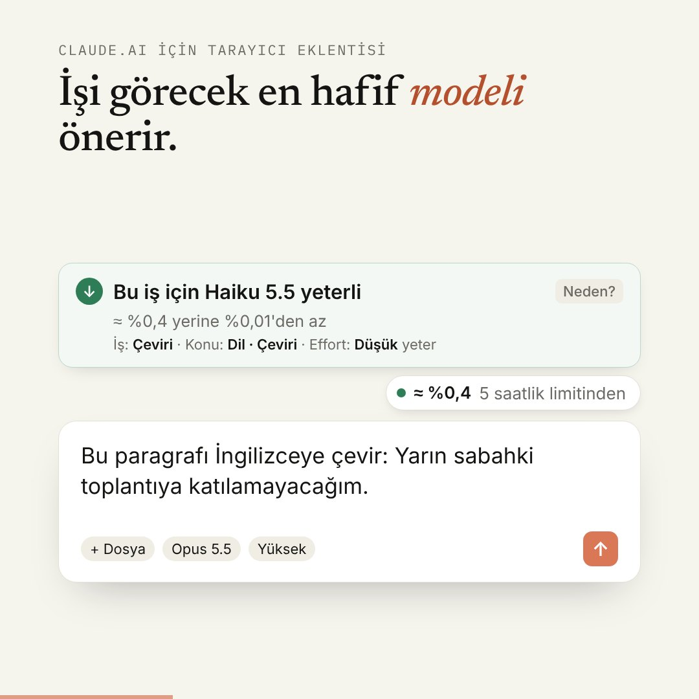
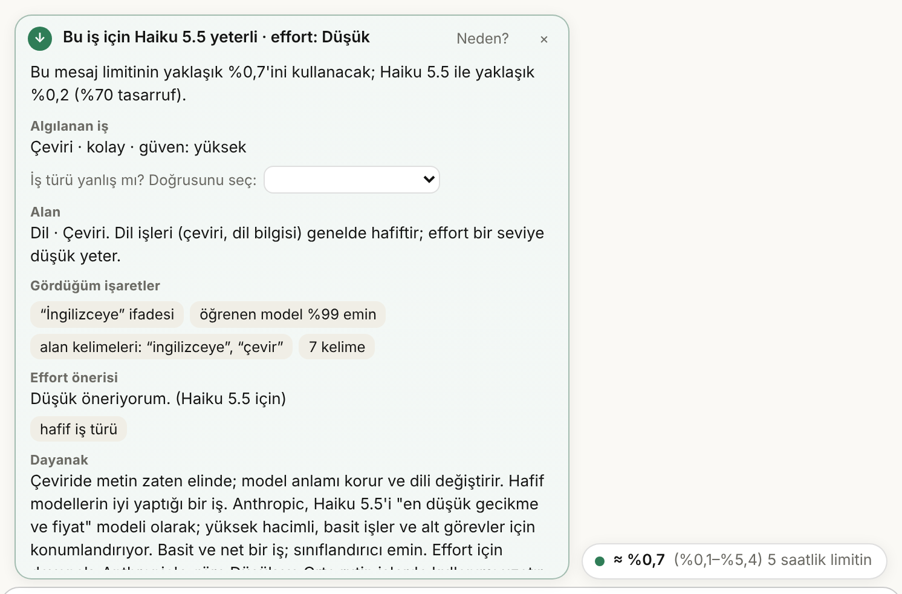
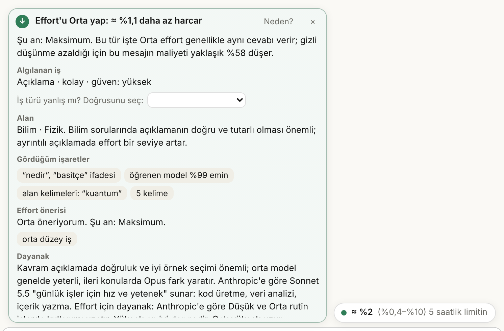
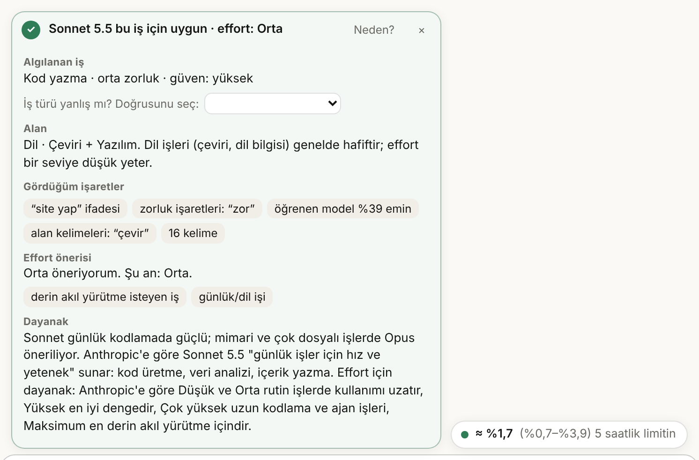
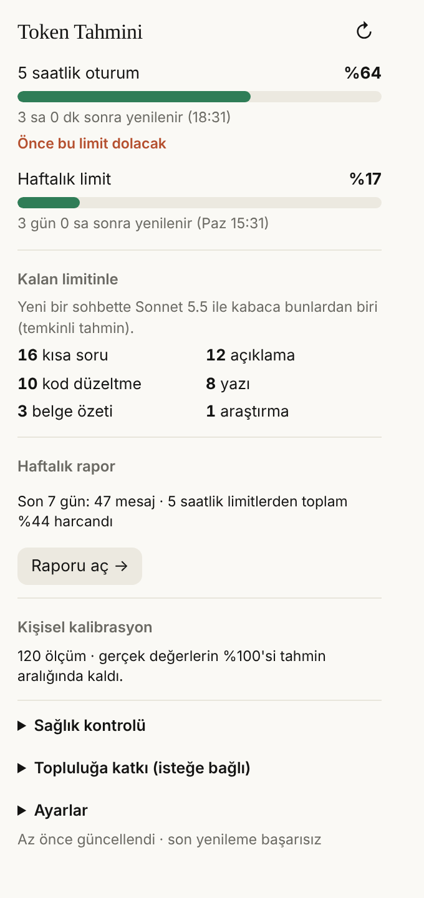
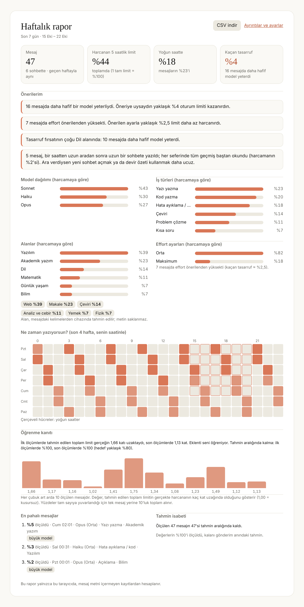

<div align="center">

# Token Tahmini / Token Forecast

**Bir mesajın ne kadar limit harcayacağını göndermeden önce bil.**

[English README](README.md) · [Web sitesi](https://h-enes1.github.io/ai-assistant-claude/) · [Sürümler](https://github.com/H-ENES1/ai-assistant-claude/releases)

Sürüm 0.12.1 · [GNU AGPL-3.0-or-later](LICENSE)

<a href="https://h-enes1.github.io/ai-assistant-claude/"></a>

</div>


claude.ai'de bir mesajın 5 saatlik ve haftalık Claude limitinin ne kadarını kullanacağını **göndermeden önce** tahmin eden, hangi modelin yeteceğini gerekçesiyle söyleyen, fazla harcamanın nedenini açıklayan ve kullandıkça cihazda öğrenen tarayıcı eklentisi. 10 dil arayüzü (Türkçe, İngilizce, Almanca, Fransızca, İspanyolca, İtalyanca, Portekizce, Rusça, Japonca, Çince); mesaj analizi yalnızca Türkçe ve İngilizce mesajlarda. Chrome, Opera, Edge, Brave (Chromium 116+). Çeviriler makine çevirisidir, anadili konuşan biri gözden geçirmedi.

© 2026 Hayrettin Enes Karalı. [GNU AGPL-3.0-or-later](LICENSE) ile açık kaynak: okuyabilir, çalıştırabilir, değiştirebilir ve paylaşabilirsin; değiştirilmiş sürüm dağıtırsan aynı lisansla ve kaynak koduyla yayımlamalı, telif bildirimini korumalısın. **"Token Tahmini" / "Token Forecast" adı ve logo lisans dışındadır** ([NOTICE](NOTICE)). Bu proje Anthropic ile bağlantılı değildir.


## Ekran görüntüleri

> Ekran görüntüleri gerçek hesaptan değil, test ortamından (sahte claude.ai sayfası) alındı.

 

 



## Ne yapar?

**Önce**
- **Göndermeden önce tahmin:** Prompt, ekler (görsel, PDF, Word, Excel, metin), sohbet geçmişi, model, effort ve önbellek durumundan limit yüzdesini %80 aralıkla verir.
- **Gerekçeli model önerisi:** Hangi modelin yeteceğini, neye baktığını (işaretler, öğrenen modelin güveni), dayanağını ve ne kadar kazandıracağını söyler. Emin değilse hafif model önermez. 👍/👎 ve "iş türü yanlış mı?" düzeltmesiyle sana göre ayarlanır.
- **Konu alanı (yeni, 0.11):** Mesajın alanını ve alt başlığını tanır: Bilim (fizik, kimya, biyoloji, astronomi, yer bilimleri), Matematik, Mühendislik (elektrik-elektronik, makine, inşaat, kontrol), Yazılım, Veri ve yapay zekâ, Akademik yazım, Proje ve planlama, Edebiyat (şiir, kurgu, inceleme, senaryo), İş ve kariyer, Ekonomi ve finans, Hukuk, Sağlık, Ders ve sınav, Dil, Tarih-felsefe-toplum, Günlük yaşam. 173 kuralda 2.600'e yakın TR+EN terim ve kök; metin cihazdan çıkmaz.
- **Effort önerisi (yeni, 0.11):** Modelin yanında effort'u da önerir (Düşük, Orta, Yüksek, Çok yüksek, Maksimum). Mevcut ayar fazlaysa ne kadar kazandıracağını, azsa neden yükseltmek gerektiğini söyler. İş türü, alan (sağlık/hukuk/para işlerinde en az Orta; yaratıcı yazıda en fazla Orta; ispatta en az Yüksek; Opus'ta zor kodlamada Çok yüksek), karmaşıklık ve senin 👍/👎'na göre. Sayfada effort okunamazsa modelin varsayılanı (Opus 5.5 ve Haiku 5.5'te Orta, diğerlerinde Yüksek) kullanılır.
- **Taşınabilir hap (yeni, 0.11):** Hapı sürükleyip istediğin yere koyabilirsin (Alt + ok tuşlarıyla da); konum hatırlanır, kartta "Hapı eski yerine al" var. claude.ai'nin kendi menüsü (model/effort seçici) hapın üstüne açılınca hap kendiliğinden geri çekilir.
- **Harcamanın dökümü (yeni):** Maliyetin ne kadarı cevaptan, düşünmeden, geçmişten, eklerden geliyor.
- **Önbellek ve yoğun saat geri sayımı (yeni):** Geçmiş kaç dakika daha ücretsiz okunur, yoğun saat ne zaman biter.

**Harcarken**
- **Bu hızla ne zaman dolar? (yeni):** Son bir saatteki hıza göre 5 saatlik limitin yenilenmeden dolup dolmayacağı.
- **Devir özeti (yeni):** Uzun sohbette yeni sohbete taşımak için hazır özet istemini kopyalar.
- **Uyarılar ve bildirimler:** Sığmaz/sığmayabilir, bağlam penceresi, önbellek, yoğun saat; %50/%75/%90 eşik ve "limit yenilendi" bildirimleri, araç çubuğu rozeti.

**Sonra**
- **"Neden bu kadar harcadı?" (yeni):** Ölçülen değer tahminin çok üstündeyse olası nedenleri söyler.
- **Haftalık rapor:** Mesaj sayısı, harcanan limit, yoğun saat payı, model ve iş dağılımı, **alan ve alt başlık dağılımı, effort dağılımı ve "effort önerilenden yüksekti" tasarrufu (0.11)**, 7×24 saat haritası, en pahalı mesajlar, tahmin isabeti ve kişisel öneriler. Pazartesi sabahı bildirim, CSV dışa aktarma.

**Öğrenir**
- **Kişisel kalibrasyon:** Her mesajdan önce ve sonra okunan kullanım yüzdesinden planın büyüklüğünü (k), yoğun saat etkisini ve cevap uzunluklarını öğrenir.
- **Cihazda öğrenen iş türü modeli (yeni):** Kurallar + küçük bir lojistik regresyon modeli (128 KB). Kullanıcı düzeltmeleri cihazda öğrenilir; metin saklanmaz, yalnızca ağırlık farkları.
- **Topluluk katkısı (yeni, isteğe bağlı):** Öğrenilen değerlerin metin içermeyen özeti kullanıcı onayıyla kopyalanır ve forma yapıştırılır; `tools/aggregate.mjs` bunları birleştirip `lib/community-priors.js`'e yazar.

## Kurulum (geliştirici modu)

Mağaza yayını hazırlanıyor. Şimdilik [Sürümler](https://github.com/H-ENES1/ai-assistant-claude/releases) sayfasından zip'i indir.

1. Zip'i bir klasöre çıkar (içinde doğrudan `manifest.json` olmalı).
2. `chrome://extensions` (Opera: `opera://extensions`) → **Geliştirici modu** açık.
3. **Paketlenmemiş öğe yükle** → klasörü seç. claude.ai sekmesini yenile.

Güncellerken öğrendiklerini kaybetmemek için eskisini kaldırmadan önce Ayarlar → **Verimi dışa aktar**, yenisini kurunca **Verimi içe aktar**.

## Nasıl çalışır?

```
maliyet = w_model × [ yeni girdi + önbellekte olmayan geçmiş + araç girdisi + 5 × (cevap + düşünme) ]
limit %  = k_plan × maliyet   (yoğun saatte ayrı öğrenilen k)
```

- **Token sayımı:** TR / EN / kod için ayrı katsayılar.
- **Cevap uzunluğu:** Log-normal; iş türü başına CASTILLO veri setinden öğrenilen katsayılar.
- **İş türü:** Kurallar (12 tip, TR+EN) puan üretir; öğrenen model bu puanları ve kelime/karakter özelliklerini birlikte kullanır (`lib/learn.js`, ağırlıklar `lib/learn-weights.js`, eğitim `tests/ml/train.mjs`).
- **Belirsizlik:** Monte Carlo (800 örnek, tekrarlanabilir).
- **Kalibrasyon:** k için Gamma-Poisson, cevap uzunluğu için hiyerarşik normal; aykırı değer filtresi, 45 günlük yarı ömür.
- **Ölçüm:** claude.ai mesajı bir Web Worker'dan gönderdiği için asıl yol sayfa yapısıdır (son kullanıcı mesajı değişti = gönderim; ondan sonra gelen cevap durdu = bitti). Kullanım gönderim anında ve cevaptan 4 sn ve 30 sn sonra okunur.

## Ölçülen doğruluk (dürüst sayılar)

| | Kurallar | Kurallar + öğrenen model |
|---|---|---|
| İş türü, test 2 (120 gündelik mesaj, hiç bakılmadan yazıldı) | %64 | %88 |
| İş türü, test 1 (120 mesaj; eğitim verisi genişletilirken görüldü) | %61 | %90 |
| Tehlikeli hata (zor işi hafif tip sanmak), iki test | 16 | 4 |
| Doğru Haiku önerisi / yanlış Haiku önerisi (iki test) | 32/80 · 0 | 66/80 · 1 |
| Öneri test seti (60 prompt): uygunluk · gerekenden hafif | %100 · 0 | %100 · 0 |

**Konu alanı (0.11, anahtar kelime):** geliştirme seti 159 istek %99; set 2 ilk ölçümde kördü, %59 (sonra sözlük buna bakarak genişletildi); set 3 sözlük bittikten sonra yazıldı, ilk ölçüm **%72 kabul edilebilir, 6 yanlış alan**; 4 yanlış tetikleme hatası düzeltildikten sonra %71, 1 yanlış alan. Hataların çoğu "Genel"e düşmek (alan yok sayılır, öneri değişmez); yanlış alana gitmek seyrek.

**Effort önerisi:** kural tabanlı, 29 birim testi (çeviri → Düşük, kavram açıklama → Orta, ispat → en az Yüksek, Opus'ta zor kodlama → Çok yüksek, riskli alanlarda hiç Düşük yok, sıradan işte hiç Maksimum yok). Önerilen effort'un cevap kalitesini gerçekten koruduğu ölçülmedi; dayanak Anthropic'in belgesi ve destek makalesi.

Eğitim ve test mesajlarını da proje yazdı; gerçek kullanıcı mesajlarıyla doğruluk ölçülmedi. Cevap kalitesi (önerilen model gerçekten yeterli miydi?) ölçülmedi.

## Gizlilik

İlk kurulumda bir onay sayfası eklentinin tam olarak neyi okuyup sakladığını gösterir; **onay verene kadar hiçbir şey okunmaz**. Her şey tarayıcıda hesaplanır. Mesaj metni, ek ve sohbet içeriği cihazdan çıkmaz; eklentinin sunucusu, analitiği, izlemesi yoktur. Gönderim kayıtları (haftalık rapor için) ve öğrenilen değerler metin içermez. Topluluk katkısı yalnızca kullanıcı görüp kopyalarsa paylaşılır. Ayrıntılar: [gizlilik politikası](https://h-enes1.github.io/ai-assistant-claude/privacy.html).

## Bilinen sınırlamalar

- claude.ai'nin belgelenmemiş iç yapısına dayanır; kırılgan modüller: `lib/usage.js`, `lib/page.js`, `lib/conversation.js`, `inject/hook.js`.
- Düşünme tokenları görünmez; yalnızca kullanım değişiminden dolaylı öğrenilir.
- Aynı hesap başka cihazda ya da Claude Code'da aynı anda kullanılırsa ölçüm bozulabilir (aykırı değer filtresi ve "başka yerde kullanım" açıklaması).
- Plan limit büyüklükleri ve yoğun saat çarpanı başlangıçta kaba tahmindir.

## Kaynaklar ve atıflar

- **CASTILLO** (veri CC BY 4.0, kod Apache 2.0): Perez-Ramirez, Kostic, Boman. https://arxiv.org/abs/2505.16881
- **lugia19/Claude-Usage-Extension** (GPL-3.0): claude.ai iç yapısı hakkındaki herkese açık gözlemler; kod kullanılmadı.
- **Anthropic model seçme rehberi:** https://platform.claude.com/docs/en/about-claude/models/choosing-a-model
- **Anthropic effort belgesi:** https://platform.claude.com/docs/en/build-with-claude/effort
- **Anthropic destek: model, effort ve düşünme ayarları:** https://support.claude.com/en/articles/8664678-change-the-model-effort-and-thinking-settings
- **Yoğun saat:** TechRadar (27.03.2026).

## Görünüm anahtarları (0.11.2)
Ayarlar → **Görünüm**: "Tam" (tahmin + tüm öneriler) ya da "Sade" (yalnızca tahmin ve limit/bağlam uyarıları). Altında tek tek anahtarlar: model önerisi, effort önerisi, ipuçları (önbellek, yoğun saat, uzun sohbet, devir özeti), "neden bu kadar harcadı?" açıklaması. Tahmin, limit dolma ve bağlam uyarıları her zaman görünür.

## Geliştirme
```bash
npm install     # esbuild + playwright
npm test        # birim, öğrenme, rapor, katkı, öneri, effort, konu, tuzak ve dil testleri
npm run e2e     # sahte claude.ai'ye karşı Playwright (60 kontrol)
npm run proof   # sanal kullanıcılarla öğrenme kanıtı
npm run build   # dist/ içinde küçültülmüş mağaza paketi
```
Ayrıntılı proje kuralları ve yapı için `CLAUDE.md`. Katkılar (hata bildirimi, seçici düzeltmeleri, **çeviri düzeltmeleri**, topluluk özetleri) memnuniyetle karşılanır.
